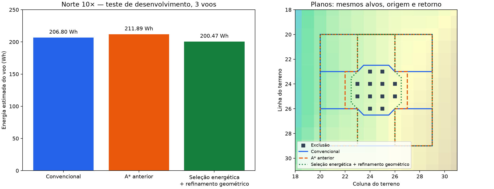

# Protótipo energético: teste de desenvolvimento — 30/10/2026

A nova seleção teve redução estimada de **3.059% frente à referência**
e **5.387% frente ao A* anterior**, neste único cenário conhecido.
Foram três voos físicos no CoppeliaSim, todos elegíveis, com 100% de cobertura,
sem colisões, violações de altura ou intervalos fora do envelope energético.
O modelo de energia não foi alterado ou calibrado; não se mediu bateria elétrica.
Esta tabela corresponde à repetição completa após uma interrupção externa.
Ao todo foram **seis voos iniciados: cinco elegíveis e um interrompido**, todos
preservados em [todos os voos](resultados/energia_desenvolvimento_20261030/todos_voos.csv).

| Método | Wh estimados | Duração (s) | Distância (m) | Subida (m) | Cobertura |
| --- | ---: | ---: | ---: | ---: | ---: |
| Convencional | 206.799 | 437.45 | 1727.8 | 193.0 | 100% |
| A* anterior | 211.888 | 454.00 | 1800.2 | 131.7 | 100% |
| Seleção energética + refinamento geométrico | 200.473 | 429.70 | 1696.5 | 120.8 | 100% |



## Implementação

O módulo `src/energy_planning.py` avalia um conjunto fixo de 13 candidatos:
referência convencional; A* com pesos de subida 0 e 10, nas orientações horizontal
e vertical; e versões desses quatro planos com atalhos de visibilidade e com
refinamento geométrico das conexões. Todos mantêm os alvos obrigatórios na ordem,
origem, retorno e exclusões. Segmentos geométricos são amostrados com o mesmo
passo espacial máximo da referência. A seleção minimiza Wh previstos em percurso
ideal a velocidade 3D constante, rejeitando cobertura insuficiente, segmentos
obstruídos, saída do terreno físico e violações previstas do envelope energético.
A altura entre waypoints também é verificada por amostragem; a execução mantém
a monitoração de segurança física. A previsão não simula o controlador.

A referência participa como alternativa; quando for escolhida, isso será declarado
como fallback e não como melhoria do A*. O planejador legado permanece disponível
e continua sendo o padrão; o protótipo é ativado por `--energy-planning`.

## Origem da melhoria e limites

O candidato escolhido foi `astar_peso_0_vertical_geometria`.
Fallback convencional selecionado: **False**.
Sem refinamento geométrico, a escolha por energia entre rotas originais seria
`convencional`; incluindo apenas atalhos, seria `convencional`.
Estas duas últimas observações são previsões ideais dos candidatos, não voos extras.

Neste caso, o A* anterior já escolhia faixas verticais. Os pesos 0 e 10 produziram
as mesmas rotas por orientação. A melhoria sobre o A* anterior veio do refinamento
geométrico das conexões; não há evidência isolada de ganho por trocar o peso de subida
ou a regra de seleção neste cenário. Frente à referência horizontal, a orientação
vertical refinada também contribui. A geometria é uma técnica disponível a outros
planejadores; este resultado não prova superioridade do A* isoladamente.

Uma checagem posterior de atribuição construiu, sem A*, uma referência geométrica
com faixas verticais por transposição do terreno. Ela produziu **exatamente a mesma
sequência de pontos** da nova rota selecionada. Portanto, neste cenário, a melhoria
pode ser obtida por orientação e geometria sem A*. Esse controle é uma análise de
rotas, não um quarto voo; seu [registro está preservado](resultados/energia_desenvolvimento_20261030/controle_geometrico.json).

O norte 10× foi escolhido antes dos voos por ser o exemplo discutido no diagnóstico,
não após testar as novas rotas em vários terrenos. É um recorte já conhecido,
amplificado sinteticamente: **desenvolvimento, não validação independente**.
O lote anterior de nove pares negativos foi preservado e não é substituído por
este exemplo. O próximo passo é incluir um controle geométrico que também escolha
horizontal/vertical por energia, congelar a proposta e testar terrenos novos,
incluindo planos e adversos. Não há garantia de economia em outras missões.

Foram mantidos velocidade 4 m/s, altura-alvo 100 m, mínimo 55 m, faixa 120 m,
espaçamento 90 m, passo temporal 0,05 s e o mesmo modelo de energia/controlador.
As rotas da referência e do A* anterior coincidem exatamente com os planos
registrados no lote anterior para norte 10×. Os três voos desta tabela são novos.
São condições demonstrativas: cobertura geométrica não comprova dose/deposição,
e a escala 1:100 e o controlador ainda exigem validação física independente.

## Verificação e reprodução

Suíte completa: **220 testes passaram**, com 50 avisos de depreciação do rasterio.
Os arquivos de implementação foram congelados antes dos voos e conferidos por SHA256.
Uma tentativa anterior apenas exportou planos e encontrou a API ainda iniciando;
nenhum voo ocorreu nessa tentativa.

Na primeira coleta física (`physical_flights`), a referência e o A* anterior
concluíram normalmente; a nova proposta foi interrompida no retorno, com 58/59
waypoints de status. O executor acusou ausência de novos passos físicos após
uma lacuna de relógio superior a três horas. Os eventos do Windows confirmam
suspensão às 20:10:09 e retorno às 23:24:06 de 30/10/2026. A energia parcial
de 194,139 Wh desse voo **não conta como economia**: missão incompleta e inelegível.
Os [eventos](resultados/energia_desenvolvimento_20261030/power_events.json) e
o [motivo da repetição](resultados/energia_desenvolvimento_20261030/retry_reason.json)
estão preservados. Os três métodos foram repetidos em `physical_retry`, com
exatamente os mesmos planos congelados e parâmetros; a tabela principal usa
essa repetição completa. A interrupção continua no total de seis tentativas,
sem ser substituída ou transformada em ganho.

```powershell
python -m src.coverage_comparison --scenario configs/development_energy.yaml --energy-planning --executor lua --disable-rendering --time-step 0.05 --port 23060 --output output/experiments/energia_nova_execucao
```

A API deve estar pronta e a simulação parada; a pasta de saída precisa ser nova.
O experimento integral está em `output/experiments/energy_development_20261030`.
Consulte [os três voos](resultados/energia_desenvolvimento_20261030/comparison.csv),
[todos os candidatos](resultados/energia_desenvolvimento_20261030/candidatos.csv)
e [o protocolo](resultados/energia_desenvolvimento_20261030/protocol.json).
