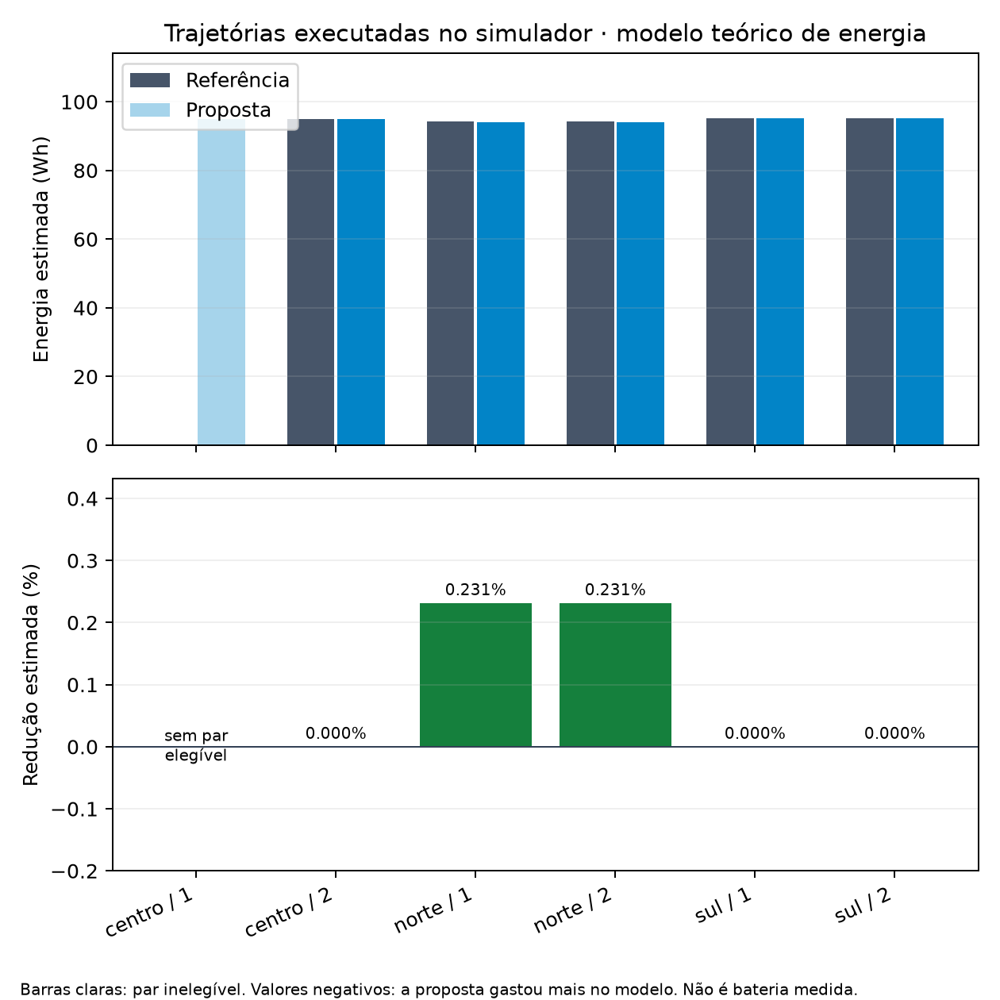
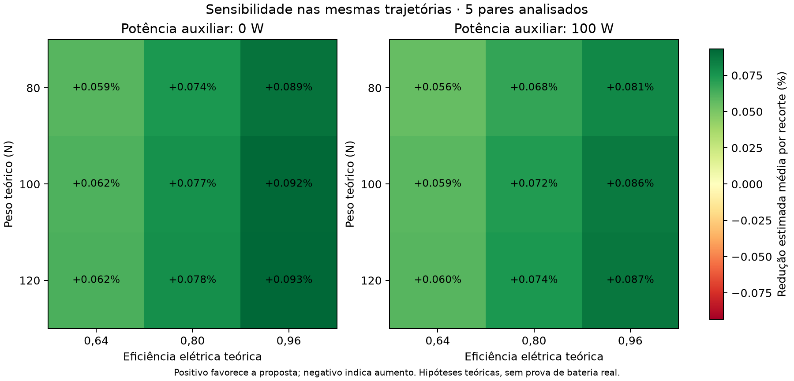

# Resultado do benchmark de 28/10/2026

> **Resultado histórico:** este lote usa A* nos dois lados. Não representa a comparação com referência convencional sem A*. Consulte `REFERENCIA_CONVENCIONAL.md` para a revisão de 29/10/2026.

O experimento principal executou 30 tentativas no CoppeliaSim: três recortes
TOPODATA, duas repetições e cinco variantes. **29 voos concluíram com segurança,
cobertura geométrica de 100% e estimativa energética dentro do envelope.**
Uma referência do centro não avançou antes do watchdog; o registro permanece
no conjunto e invalida o primeiro par, sem substituição ou ganho inventado.
Os pilotos de desenvolvimento ficam separados do lote principal.

## Resultado observado no passo padrão de 0,05 s

| Recorte | Repetição | Referência (Wh estimados) | Proposta (Wh estimados) | Redução estimada (%) | Par elegível |
| --- | --- | --- | --- | --- | --- |
| centro | 1 | — | 94,919423 | — | Não |
| centro | 2 | 94,919423 | 94,919423 | 0,000000 | Sim |
| norte | 1 | 94,365454 | 94,147082 | 0,231411 | Sim |
| norte | 2 | 94,365454 | 94,147082 | 0,231411 | Sim |
| sul | 1 | 95,075924 | 95,075924 | 0,000000 | Sim |
| sul | 2 | 95,075924 | 95,075924 | 0,000000 | Sim |

Houve 2 reduções, 3 empates e
0 aumentos nos 5 pares elegíveis
dos 6 previstos. A média por par elegível foi
0,092564%; a média com o mesmo
peso por recorte foi **0,077137%**.
Essas médias têm ponderações distintas e não incluem um valor inventado para
o par inelegível. As repetições foram determinísticas.



No norte, o ganho foi de aproximadamente 0,218372 Wh por missão. A duração
foi igual, 228,30 s; a subida acumulada foi de 19,8933 m para 13,6081 m,
redução de aproximadamente 31,59% nesse componente. O voo horizontal e a
sustentação ocupam a maior parte da energia estimada, por isso a redução
total ficou em 0,231411%.

## Contribuição do algoritmo

| Variante versus referência | Redução estimada média por recorte (%) |
| --- | --- |
| distancia_3d | 0,000000 |
| somente_subida | 0,000000 |
| somente_orientacao | 0,077137 |
| proposta_completa | 0,077137 |

O ganho observado veio da escolha da orientação das faixas. A penalização
de subida sozinha não mudou as rotas nestes recortes. Centro e sul tiveram
planos idênticos entre referência e proposta e permaneceram como empates.
A referência também usa A*; o rótulo é “sem otimização proposta”.
O algoritmo implementado é busca heurística em 2,5D, sem modelo aprendido.

## Sensibilidade e limite encontrado

Nas 18 hipóteses teóricas de peso, eficiência elétrica e potência auxiliar,
a média por recorte variou entre
0,055677% e
0,093306%.
Isso é uma análise das mesmas trajetórias, não 18 novas amostras ou calibração.



O diagnóstico posterior repetiu um par de cada recorte com passo de 0,025 s,
mantendo as rotas e o controlador. **Os seis voos falharam no primeiro waypoint**:
o controlador demonstrativo não manteve a altura dentro da tolerância.
Esses voos ficam em `time_step_check/` e não entram nas médias acima.
Não foi demonstrada robustez temporal do ganho. A causa específica desse
comportamento do controlador requer investigação; o teste não autoriza
atribuir toda a diferença à precisão numérica da integração.

Portanto, a conclusão suportada é uma pequena economia estimada nas condições
fixadas de um recorte. **Não está comprovada economia real de bateria nem uma
vantagem geral do algoritmo.** Para essa afirmação faltam um controlador
validado, estudo de resolução e medidas elétricas independentes do drone e carga.
Os recortes são exploratórios da mesma região; o centro foi usado no
desenvolvimento. Não representam fazendas independentes.

## Apresentação e reprodução

As três cenas ficam em `output/experiments/benchmark_20261028_v2/`:

- `presentation_centro/comparacao_lado_a_lado.ttt`: empate;
- `presentation_norte_native/comparacao_lado_a_lado.ttt`: redução estimada;
- `presentation_sul/comparacao_lado_a_lado.ttt`: empate.

Cada cena usa o primeiro par completo de seu recorte em ordem de coleta,
com referência à esquerda e proposta à direita. É um replay das telemetrias
físicas registradas, sincronizado pelo tempo original, sem nova medição.
O recorte norte fica ativo para mostrar as orientações distintas; os empates
e todas as tentativas continuam na tabela. A reprodução está em loop a 4×.

O relatório completo é `report_final/index.html`. Fontes, scripts Lua,
planos, telemetrias e hashes estão na pasta do experimento. Este resumo
versionável conserva [os 30 registros](resultados/20261028/voos.csv) e
[a proveniência](resultados/20261028/proveniencia.json).

```powershell
python -m src.benchmark --disable-rendering --output output/experiments/novo_benchmark
python -m src.time_step_check output/experiments/novo_benchmark --output output/experiments/novo_diagnostico
```

Os critérios foram iguais: origem e retorno, vento zero, controlador e
velocidade, altura, obstáculos, largura de aplicação de 120 m, espaçamento
de 90 m, exigência de 100% de cobertura geométrica e modelo energético.
O modelo é teórico e não foi calibrado para o Quadcopter em escala 1:100.
Cobertura geométrica não mede dose ou deposição de produto.
