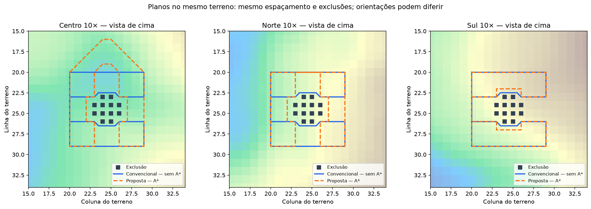
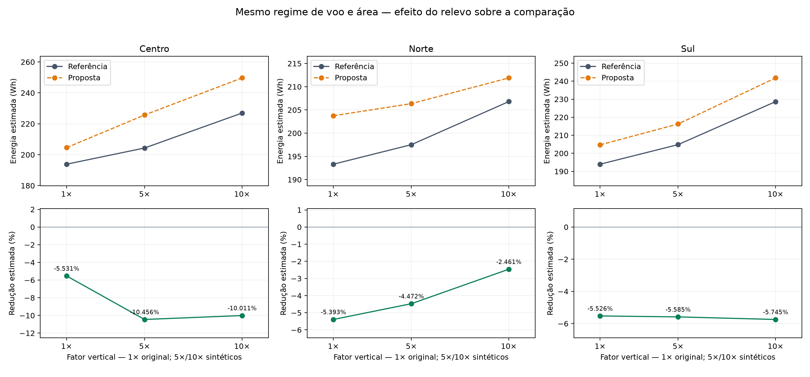
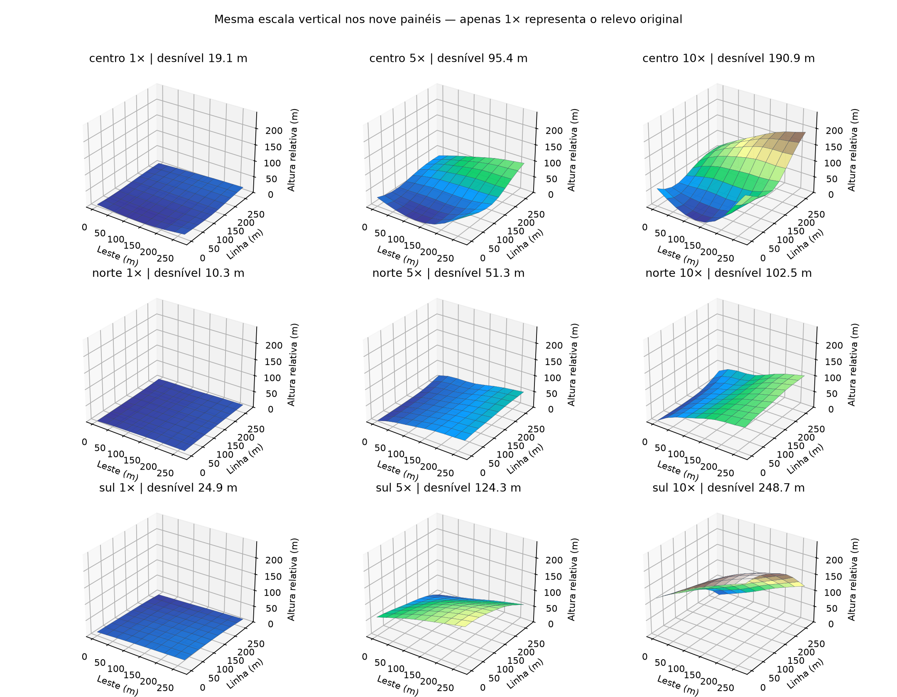

# Benchmark corrigido: faixas convencionais versus proposta A* — 29/10/2026

A referência foi corrigida: usa faixas paralelas e conexões geométricas, sem
A*. O planejador A* permanece nas variantes da proposta. Trata-se de uma
aproximação operacional explícita, não de uma cópia dos algoritmos fechados
de DJI ou XAG. A chave `referencia_2d` foi mantida nos CSVs por compatibilidade;
o protocolo identifica a versão `parallel_geometric_v1`.

Foram registrados **18 voos**, com **9/9 pares elegíveis**.
A proposta teve redução estimada em 0 pares, empate em 0 e
aumento em 9. Valores negativos nas tabelas significam maior gasto
da proposta. Falhas e ausências permanecem no denominador.

A proposta A* atual não demonstrou economia de energia neste lote.
A suíte automatizada passou com **215 testes**. Os 18 voos concluíram com
100% de cobertura, sem colisões, violações de altura ou intervalos fora do
envelope energético. Essa conclusão é sobre energia estimada nas condições
demonstrativas fixadas, sem validação elétrica de bateria.

Os resultados históricos usavam A* também na referência. Eles foram
preservados e identificados como históricos; seus ganhos não são evidência
de vantagem sobre esta nova referência convencional.

## O que mudou na referência

As passadas seguem o maior lado do talhão, com direção horizontal no empate,
sem consultar relevo ou energia. Nos obstáculos, um grafo de visibilidade
com Dijkstra por distância XY conecta os pontos. Os segmentos são retos em
XY e amostrados em coordenadas contínuas; não há caminho em escada produzido
por busca A*. Os dois métodos usam a mesma conversão de altitude e controlador.

Foram testados os mesmos três recortes com fatores verticais de 1×, 5× e 10×. Apenas 1× representa o TOPODATA original; os demais são terrenos sintéticos derivados.

O cenário 1× foi reexecutado no mesmo regime dos demais: 4.0 m/s, altura-alvo de 100.0 m, largura de aplicação de 120.0 m e faixas a cada 90.0 m. Os dois métodos usam a mesma origem, retorno, controlador, terreno e modelo de energia. Passos temporais registrados: 0.050 s.

## Comparação por missão

| Recorte | Fator | Desnível (m) | Referência (Wh) | Proposta (Wh) | Redução estimada (%) | Cobertura ref./prop. (%) | Par válido |
| --- | --- | --- | --- | --- | --- | --- | --- |
| centro | 1× | 19.1 | 193.866 | 204.589 | -5.531 | 100.0/100.0 | Sim |
| norte | 1× | 10.3 | 193.320 | 203.746 | -5.393 | 100.0/100.0 | Sim |
| sul | 1× | 24.9 | 193.977 | 204.696 | -5.526 | 100.0/100.0 | Sim |
| centro | 5× | 95.4 | 204.347 | 225.714 | -10.456 | 100.0/100.0 | Sim |
| norte | 5× | 51.3 | 197.523 | 206.357 | -4.472 | 100.0/100.0 | Sim |
| sul | 5× | 124.3 | 204.828 | 216.267 | -5.585 | 100.0/100.0 | Sim |
| centro | 10× | 190.9 | 226.957 | 249.679 | -10.011 | 100.0/100.0 | Sim |
| norte | 10× | 102.5 | 206.799 | 211.888 | -2.461 | 100.0/100.0 | Sim |
| sul | 10× | 248.7 | 228.659 | 241.795 | -5.745 | 100.0/100.0 | Sim |

## Resultado por nível de relevo

| Fator | Pares válidos/previstos | Redução média por recorte (%) | Reduções / empates / aumentos |
| --- | --- | --- | --- |
| 1× | 3/3 | -5.483 | 0 / 0 / 3 |
| 5× | 3/3 | -6.838 | 0 / 0 / 3 |
| 10× | 3/3 | -6.072 | 0 / 0 / 3 |

Se os conjuntos elegíveis diferirem entre os fatores, as médias agregadas não constituem uma comparação completa do efeito do relevo. A leitura principal deve acompanhar a mesma origem nos três níveis.

## Distância, duração e subida executadas

| Recorte | Fator | Distância ref./prop. (m) | Duração ref./prop. (s) | Subida ref./prop. (m) |
| --- | --- | --- | --- | --- |
| centro | 1× | 1666.9/1767.8 | 422.4/445.9 | 34.1/36.6 |
| norte | 1× | 1665.5/1766.0 | 422.3/445.8 | 19.8/13.7 |
| sul | 1× | 1666.8/1767.7 | 422.3/445.8 | 38.7/41.1 |
| centro | 5× | 1714.2/1909.6 | 434.2/481.3 | 168.4/168.6 |
| norte | 5× | 1681.0/1774.5 | 425.4/447.4 | 96.8/66.2 |
| sul | 5× | 1713.5/1817.1 | 433.6/457.9 | 191.4/203.0 |
| centro | 10× | 1846.6/2055.5 | 468.4/518.9 | 337.0/334.3 |
| norte | 10× | 1727.8/1800.2 | 437.5/454.0 | 193.0/131.7 |
| sul | 10× | 1849.5/1961.1 | 468.6/495.5 | 382.4/406.0 |

## Segurança e limites do modelo energético

| Recorte | Fator | Colisões ref./prop. | Violações de altura ref./prop. | Menor altura ref./prop. (m) | Intervalos fora do envelope ref./prop. |
| --- | --- | --- | --- | --- | --- |
| centro | 1× | 0/0 | 0/0 | 98.0/98.0 | 0/0 |
| norte | 1× | 0/0 | 0/0 | 99.5/99.7 | 0/0 |
| sul | 1× | 0/0 | 0/0 | 98.7/99.1 | 0/0 |
| centro | 5× | 0/0 | 0/0 | 88.1/87.2 | 0/0 |
| norte | 5× | 0/0 | 0/0 | 94.9/96.3 | 0/0 |
| sul | 5× | 0/0 | 0/0 | 91.1/92.9 | 0/0 |
| centro | 10× | 0/0 | 0/0 | 76.8/73.7 | 0/0 |
| norte | 10× | 0/0 | 0/0 | 89.4/92.0 | 0/0 |
| sul | 10× | 0/0 | 0/0 | 81.7/85.6 | 0/0 |

As métricas de voos inelegíveis podem ser parciais. Elas ficam identificadas na primeira tabela e não sustentam comparação de economia.

## A vantagem cresceu com o relevo?

Em centro, o resultado do último nível ficou mais desfavorável à proposta. A mudança entre o último e o primeiro nível foi de -4.480 pontos percentuais.
Em norte, a desvantagem estimada diminuiu, mas a proposta ainda gastou mais no último nível. A mudança entre o último e o primeiro nível foi de 2.932 pontos percentuais.
Em sul, o resultado do último nível ficou mais desfavorável à proposta. A mudança entre o último e o primeiro nível foi de -0.219 pontos percentuais.

Referência: Faixas paralelas ao maior lado do talhão (horizontal no empate); conexões retas e desvios geométricos por visibilidade/Dijkstra XY, sem A*. Sem custo de relevo ou energia na escolha da rota. Aproximação operacional, não reprodução do algoritmo fechado de fabricante.

A proposta A* escolhe entre horizontal e vertical pelo custo de distância e subida. As orientações e os custos planejados de cada caso estão no CSV. O peso de subida e o modelo energético permaneceram iguais em todos os níveis; não foram ajustados para produzir ganho.

O custo de distância 3D + peso × subida não é energia em Wh. Uma rota com menos subida pode gastar mais se aumentar distância ou duração. A escolha atual minimiza esse custo auxiliar, não diretamente a energia estimada do voo.

## Interpretação e limites

Reduções positivas favorecem a proposta; negativas representam piora. Falhas e cobertura insuficiente ficam no denominador, com redução em branco. O CSV contém também distância, duração e subida acumulada. Valores de energia de voos inelegíveis são parciais e não podem ser usados para anunciar economia.

Os fatores foram definidos antes da coleta; não se escolheu apenas o terreno favorável. As versões ampliadas são variações dos mesmos recortes, não novas fazendas independentes. Este teste mostra como o comportamento muda com o relevo nas condições registradas.

A energia é estimada por um modelo teórico não calibrado. O benchmark anterior encontrou falha do controlador ao alterar o passo para 0,025 s. O presente experimento mantém 0,05 s e não resolve essa limitação. Não comprova economia real de bateria nem generalização.

O comparativo anterior usava 8 m/s e altura-alvo de 60 m. Seus Wh não devem ser comparados diretamente aos atuais para atribuir a diferença exclusivamente ao relevo; use o controle 1× desta coleta.

Consulte paired/index.html para os pares individuais, inclusive motivos de exclusão e rastreabilidade. As versões com relevo maior são identificadas no painel do CoppeliaSim.

## Limite operacional desta revisão

Esta revisão corrige o planejador de referência. Altura-alvo de 100 m,
faixa geométrica de 120 m e aplicação ativa em conexões e retorno continuam
sendo condições demonstrativas comuns. Não foram calibrados dose,
deposição, curvas, sensores ou carga de um veículo agrícola real. Os testes
não reproduzem uma pulverização comercial nem medem consumo elétrico real.
Um acompanhamento de terreno convencional já pode existir em equipamentos
comerciais e não é uma contribuição exclusiva do nosso A*.

## Reprodução e rastreabilidade

O lote integral está em `output/experiments/conventional_benchmark_20261029/`,
com telemetrias, cenários, terreno, protocolos e a implementação congelada.
O relatório detalhado fica em `relief_report_final/index.html`.
As cenas nativas são `presentation_centro_x10/comparacao_lado_a_lado.ttt`,
`presentation_norte_x10/comparacao_lado_a_lado.ttt` e
`presentation_sul_x10/comparacao_lado_a_lado.ttt`.
O centro10× fica ativo pela ordem do manifesto, sem consultar ganhos.
O painel identifica a referência sem A*; a cena é um replay das telemetrias,
em loop a4×, sem nova física simultânea. A GPU da apresentação foi conferida
no log do OpenGL.

Consulte [todos os voos](resultados/convencional_20261029/voos.csv),
[as comparações](resultados/convencional_20261029/comparacao.csv),
[os níveis de relevo](resultados/convencional_20261029/niveis.csv),
[a verificação automatizada](resultados/convencional_20261029/verificacao.json)
e [a proveniência](resultados/convencional_20261029/proveniencia.json).
O [registro de congelamento](resultados/convencional_20261029/auditoria_protocolo.json)
confere os arquivos de planejamento, execução e configuração com o snapshot
do início da coleta; não houve ajuste de rotas ou energia após os resultados.

O próximo desenvolvimento deve otimizar a energia total, incluindo duração
e conexões, preservando esta referência competente. Uma nova regra precisa
ser congelada em dados de desenvolvimento antes de avaliar outros terrenos.
Controlador, resolução temporal, parâmetros agronômicos e modelo energético
continuam exigindo validação independente. Não ajustar o avaliador energético
após observar os resultados para fabricar uma vantagem.
