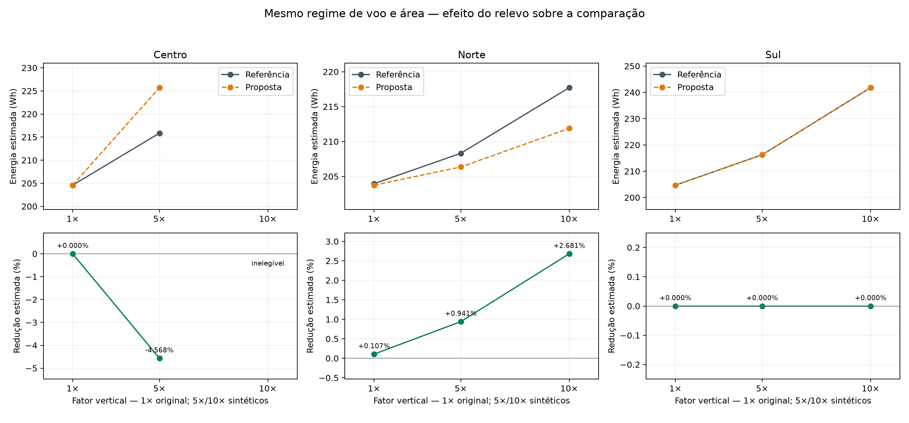
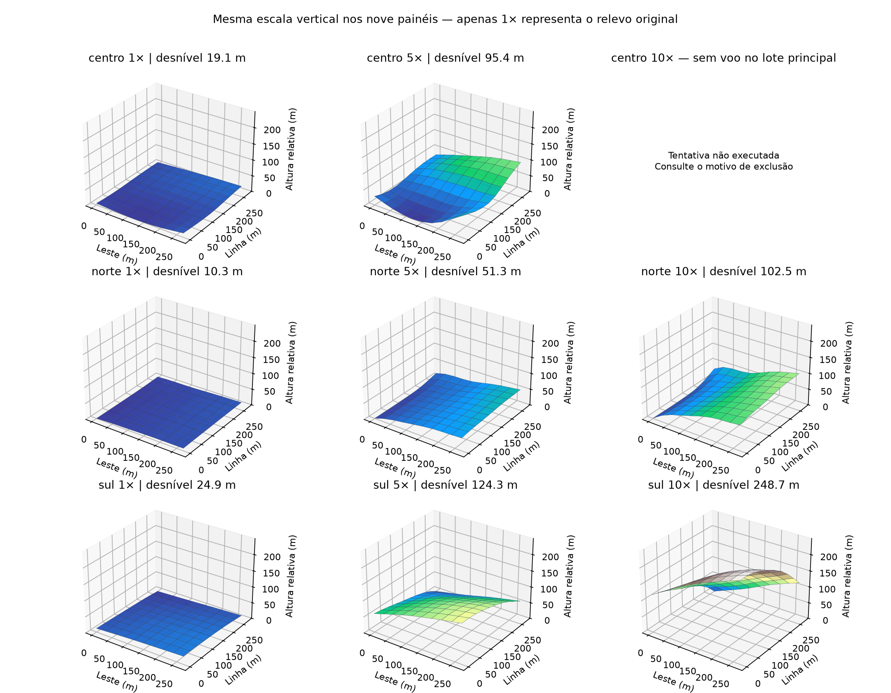

# Resultado comparativo do relevo ampliado — 28–29/10/2026

> **Resultado histórico:** este lote usa A* nos dois lados. Não representa a comparação com referência convencional sem A*. Consulte `REFERENCIA_CONVENCIONAL.md` para a revisão de 29/10/2026.

O lote principal registrou 16 voos físicos no CoppeliaSim, com 8/9 pares elegíveis. A comparação registrou reduções em 3 pares, empates em 4 e aumentos em 1. O centro 10× foi bloqueado antes da execução por falta de suporte físico de uma célula do trajeto. Esse par foi executado em separado, com terreno de suporte maior; sua falha original continua no denominador. Aumentar o relevo não demonstrou uma vantagem geral do algoritmo atual.

Foram testados os mesmos três recortes com fatores verticais de 1×, 5× e 10×. Apenas 1× representa o TOPODATA original; os demais são terrenos sintéticos derivados.

O cenário 1× foi reexecutado no mesmo regime dos demais: 4.0 m/s, altura-alvo de 100.0 m, largura de aplicação de 120.0 m e faixas a cada 90.0 m. Os dois métodos usam a mesma origem, retorno, controlador, terreno e modelo de energia. Passos temporais registrados: 0.050 s.

## Comparação por missão

| Recorte | Fator | Desnível (m) | Referência (Wh) | Proposta (Wh) | Redução estimada (%) | Cobertura ref./prop. (%) | Par válido |
| --- | --- | --- | --- | --- | --- | --- | --- |
| centro | 1× | 19.1 | 204.589 | 204.589 | 0.000 | 100.0/100.0 | Sim |
| norte | 1× | 10.3 | 203.965 | 203.746 | 0.107 | 100.0/100.0 | Sim |
| sul | 1× | 24.9 | 204.696 | 204.696 | 0.000 | 100.0/100.0 | Sim |
| centro | 5× | 95.4 | 215.854 | 225.714 | -4.568 | 100.0/100.0 | Sim |
| norte | 5× | 51.3 | 208.317 | 206.357 | 0.941 | 100.0/100.0 | Sim |
| sul | 5× | 124.3 | 216.267 | 216.267 | 0.000 | 100.0/100.0 | Sim |
| centro | 10× | — | — | — | — | —/— | Não |
| norte | 10× | 102.5 | 217.725 | 211.888 | 2.681 | 100.0/100.0 | Sim |
| sul | 10× | 248.7 | 241.795 | 241.795 | 0.000 | 100.0/100.0 | Sim |

## Tentativas inelegíveis

| Caso | Estado | Erro de execução | Motivos de exclusão |
| --- | --- | --- | --- |
| centro_x10 | failed | A rota sai do terreno físico. Aumente terrain_padding_cells antes da coleta. | voo_ausente;voo_ausente |

## Resultado por nível de relevo

| Fator | Pares válidos/previstos | Redução média por recorte (%) | Reduções / empates / aumentos |
| --- | --- | --- | --- |
| 1× | 3/3 | 0.036 | 1 / 2 / 0 |
| 5× | 3/3 | -1.209 | 1 / 1 / 1 |
| 10× | 2/3 | 1.341 | 1 / 1 / 0 |

Se os conjuntos elegíveis diferirem entre os fatores, as médias agregadas não constituem uma comparação completa do efeito do relevo. A leitura principal deve acompanhar a mesma origem nos três níveis.

## Distância, duração e subida executadas

| Recorte | Fator | Distância ref./prop. (m) | Duração ref./prop. (s) | Subida ref./prop. (m) |
| --- | --- | --- | --- | --- |
| centro | 1× | 1767.8/1767.8 | 445.9/445.9 | 36.6/36.6 |
| norte | 1× | 1766.2/1766.0 | 445.8/445.8 | 20.0/13.7 |
| sul | 1× | 1767.7/1767.7 | 445.8/445.8 | 41.1/41.1 |
| centro | 5× | 1818.6/1909.6 | 458.6/481.3 | 180.6/168.6 |
| norte | 5× | 1782.0/1774.5 | 449.2/447.4 | 97.7/66.2 |
| sul | 5× | 1817.1/1817.1 | 457.9/457.9 | 203.0/203.0 |
| centro | 10× | —/— | —/— | —/— |
| norte | 10× | 1829.6/1800.2 | 461.4/454.0 | 194.8/131.7 |
| sul | 10× | 1961.1/1961.1 | 495.5/495.5 | 406.0/406.0 |

## Segurança e limites do modelo energético

| Recorte | Fator | Colisões ref./prop. | Violações de altura ref./prop. | Menor altura ref./prop. (m) | Intervalos fora do envelope ref./prop. |
| --- | --- | --- | --- | --- | --- |
| centro | 1× | 0/0 | 0/0 | 98.0/98.0 | 0/0 |
| norte | 1× | 0/0 | 0/0 | 99.5/99.7 | 0/0 |
| sul | 1× | 0/0 | 0/0 | 99.1/99.1 | 0/0 |
| centro | 5× | 0/0 | 0/0 | 88.1/87.2 | 0/0 |
| norte | 5× | 0/0 | 0/0 | 94.9/96.3 | 0/0 |
| sul | 5× | 0/0 | 0/0 | 92.9/92.9 | 0/0 |
| centro | 10× | —/— | —/— | —/— | —/— |
| norte | 10× | 0/0 | 0/0 | 89.4/92.0 | 0/0 |
| sul | 10× | 0/0 | 0/0 | 85.6/85.6 | 0/0 |

As métricas de voos inelegíveis podem ser parciais. Elas ficam identificadas na primeira tabela e não sustentam comparação de economia.

## A vantagem cresceu com o relevo?

Em centro, faltou um par elegível em pelo menos um nível; a tendência completa permanece indeterminada.
Em norte, a vantagem estimada cresceu com o relevo. A mudança entre o último e o primeiro nível foi de 2.574 pontos percentuais.
Em sul, o resultado do último nível empatou com o controle 1×. A mudança entre o último e o primeiro nível foi de 0.000 pontos percentuais.

A referência mantém faixas horizontais; a proposta escolhe entre horizontal e vertical pelo custo de distância e subida. As orientações e os custos planejados de cada caso estão no CSV. O peso de subida e o modelo energético permaneceram iguais em todos os níveis; não foram ajustados para produzir ganho.

O custo de distância 3D + peso × subida não é energia em Wh. Uma rota com menos subida pode gastar mais se aumentar distância ou duração. A escolha atual minimiza esse custo auxiliar, não diretamente a energia estimada do voo.

## Interpretação e limites

Reduções positivas favorecem a proposta; negativas representam piora. Falhas e cobertura insuficiente ficam no denominador, com redução em branco. O CSV contém também distância, duração e subida acumulada. Valores de energia de voos inelegíveis são parciais e não podem ser usados para anunciar economia.

Os fatores foram definidos antes da coleta; não se escolheu apenas o terreno favorável. As versões ampliadas são variações dos mesmos recortes, não novas fazendas independentes. Este teste mostra como o comportamento muda com o relevo nas condições registradas.

A energia é estimada por um modelo teórico não calibrado. O benchmark anterior encontrou falha do controlador ao alterar o passo para 0,025 s. O presente experimento mantém 0,05 s e não resolve essa limitação. Não comprova economia real de bateria nem generalização.

O comparativo anterior usava 8 m/s e altura-alvo de 60 m. Seus Wh não devem ser comparados diretamente aos atuais para atribuir a diferença exclusivamente ao relevo; use o controle 1× desta coleta.

Consulte paired/index.html para os pares individuais, inclusive motivos de exclusão e rastreabilidade. As versões com relevo maior são identificadas no painel do CoppeliaSim.

## Par suplementar: centro 10×

O planejador levou a proposta até a linha 16 do grid, enquanto o terreno
físico do lote principal começava na linha 17. A checagem recusou o voo antes
da execução. O suplemento aumenta apenas o entorno de três para quatro
células, mantendo missão, rotas, algoritmo, modelo energético, velocidade,
altura e critérios. Os dois métodos usam o mesmo suporte ampliado.
Ele não substitui a tentativa original nem entra nas médias por fator acima.
Para futuras coletas completas, a configuração foi corrigida para quatro
células em todos os casos e recebeu uma regressão geométrica dos nove pares.

| Desnível | Referência (Wh) | Proposta (Wh) | Redução estimada (%) | Cobertura ref./prop. (%) | Par elegível |
| --- | --- | --- | --- | --- | --- |
| 190,873 m | 240.265 | 249.679 | -3.918 | 100.000/100.000 | Sim |

| Métrica do centro10× | Referência | Proposta |
| --- | --- | --- |
| Distância executada (m) | 1960.879 | 2055.451 |
| Duração observada (s) | 495.600 | 518.850 |
| Subida executada (m) | 361.395 | 334.322 |
| Custo auxiliar planejado (não é Wh) | 5611.289 | 5419.074 |
| Energia de voo horizontal/sustentação estimada (Wh) | 227.717 | 238.070 |
| Energia adicional de subida estimada (Wh) | 12.548 | 11.608 |

No suplemento, a proposta reduziu a subida, mas percorreu aproximadamente
94,6 m e 23,3 s a mais. A economia no componente de subida foi menor
que o acréscimo de sustentação e voo horizontal. O custo auxiliar
planejado caiu enquanto a energia estimada aumentou.

O protocolo da intervenção e os dados ficam em
[registro do reparo](resultados/relevo_20261029/reparo_centro_x10.json),
[voos suplementares](resultados/relevo_20261029/suplemento_centro_x10.csv) e
[auditoria pareada](resultados/relevo_20261029/suplemento_centro_x10.json).
O relatório completo do suplemento é
`output/experiments/relief_centro_x10_repair_20261029/report/index.html`.

## Coleta e apresentação preservadas

A coleta final usou uma instância isolada do mesmo CoppeliaSim, sem janela,
com física, controlador e passo temporal comuns. A interface de apresentação
usa a Radeon RX 560X, confirmada no log do OpenGL. O par suplementar foi
coletado em uma instância com janela, com a renderização desativada durante os voos.
As tentativas anteriores
com interrupção de scripts ou comunicação estão no histórico técnico; seus
resultados parciais não foram mesclados aos deste lote.

Os dados integrais estão em
`output/experiments/relief_benchmark_20261028_isolated/`.
O relatório HTML é `relief_report_final/index.html`. Foram salvas cenas nativas
`presentation_centro_x10/comparacao_lado_a_lado.ttt`,
`presentation_norte_x10/comparacao_lado_a_lado.ttt` e
`presentation_sul_x10/comparacao_lado_a_lado.ttt`.
O centro 10× fica ativo pela ordem do manifesto. A visualização reproduz
telemetrias registradas, em loop a 4×, sem nova física simultânea.

Este resumo conserva [todos os voos](resultados/relevo_20261029/voos.csv),
[a comparação por par](resultados/relevo_20261029/comparacao.csv),
[os níveis](resultados/relevo_20261029/resumo_niveis.csv),
[as tentativas técnicas anteriores](resultados/relevo_20261029/tentativas_anteriores.json)
e [a proveniência com hashes](resultados/relevo_20261029/proveniencia.json).

A suíte automatizada passou com 207 testes e 46 avisos de descontinuação
da dependência rasterio/Affine. O [registro da verificação](resultados/relevo_20261029/verificacao.json)
identifica o comando utilizado; a validação por testes não substitui as
limitações físicas expostas acima. A regressão adicional verifica o suporte
físico dos nove recortes antes de qualquer novo voo.

## Consequência para o desenvolvimento

A função atual de distância mais penalização de subida não minimiza os Wh
estimados do voo. O próximo experimento deve desenvolver uma seleção de
rota por custo energético coerente com duração, voo horizontal e subida,
usando terrenos de desenvolvimento. Congelar a nova regra antes de testar
outros recortes, mantendo estes resultados como referência histórica.
Não reajustar o avaliador ou selecionar apenas um relevo que produza ganho.

Em paralelo, corrigir e validar o controlador e a resolução temporal,
depois calibrar e avaliar o consumo com medições elétricas independentes.
O planejador implementado usa busca heurística A* em 2,5D e escolha de
orientação; não contém um modelo aprendido. A referência também usa A*.
Uma conclusão sobre aprendizado ou economia real de bateria exige essas
implementações e evidências adicionais.
